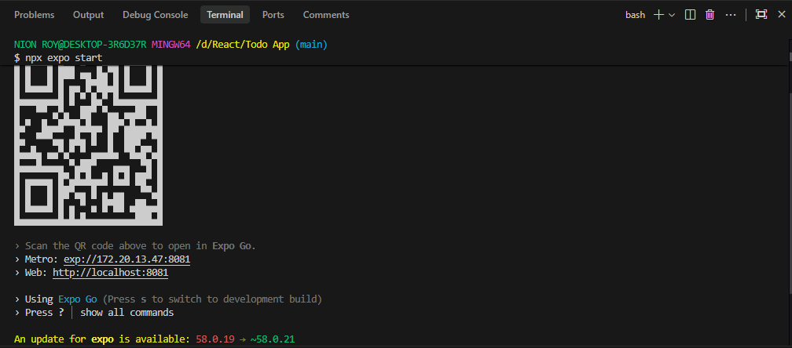

# 📋 কাজের তালিকা (Todo List Application)

<p align="center">
  
</p>

<p align="center">
  <strong>React Native ও Expo দিয়ে তৈরি আধুনিক, দ্রুত এবং সম্পূর্ণ বাংলায় সাজানো প্রোডাক্টিভিটি অ্যাপ</strong>
</p>

<p align="center">
  
  
  
  
</p>

---

## 📱 স্ক্রিনশট প্রিভিউ (Screenshots & App Preview)

> গিটহাবে পুশ করার পর অ্যাপটির স্ক্রিনশটগুলো নিচে সুন্দর গ্রিড আকারে প্রদর্শিত হবে।

<div align="center">
  <table>
    <tr>
      <td align="center" width="33.33%">
        <strong>🏠 হোম স্ক্রিন ও কাজের তালিকা</strong><br/><br/>
        
      </td>
      <td align="center" width="33.33%">
        <strong>✨ নতুন টাস্ক যুক্ত</strong><br/><br/>
        
      </td>
      <td align="center" width="33.33%">
        <strong>🚀 Expo সার্ভার রান (<code>npx expo start</code>)</strong><br/><br/>
        
      </td>
    </tr>
  </table>
</div>

---

## ✨ মূল বৈশিষ্ট্যসমূহ (Key Features)

- **📝 সহজ ও আকর্ষণীয় টাস্ক ম্যানেজমেন্ট**: যেকোনো কাজের নাম, নির্দিষ্ট ক্যাটাগরি এবং প্রায়োরিটি দিয়ে নিমেষেই টাস্ক যুক্ত করা যায়।
- **🏷️ সুসংগঠিত ৩টি ক্যাটাগরি**:
  - 👤 **ব্যক্তিগত (Personal)**
  - 💼 **অফিস (Work)**
  - 📖 **পড়াশোনা (Study)**
- **⚡ ৩ স্তরের গুরুত্ব (Priority Levels)**:
  - 🔵 **সাধারণ (Low)**
  - 🟡 **মাঝারি (Medium)**
  - 🔴 **জরুরি (High)**
- **🔍 ইনস্ট্যান্ট লাইভ সার্চ**: কাজের শিরোনাম, ক্যাটাগরি বা প্রায়োরিটি লিখে সরাসরি রিয়েল-টাইম সার্চ সুবিধা।
- **📑 স্মার্ট ফিল্টারিং**:
  - `সব কাজ` (All)
  - `চলমান` (Active)
  - `সম্পন্ন` (Completed)
- **📄 পেজিনেশন (Pagination)**: প্রতি পাতায় সুনির্দিষ্ট সংখ্যক কাজ রেখে সহজে নেভিগেট করার সুবিধা।
- **⏳ আধুনিক স্কেলেটন লোডার (Skeleton Loader)**: সার্চ বা পেজ পরিবর্তনের সময় ব্যবহারকারীকে নিখুঁত ও প্রিমিয়াম অভিজ্ঞতার জন্য শিমার/স্কেলেটন লোডিং এফেক্ট।
- **📊 সারাংশ ও অগ্রগতি কার্ড (Stats Card)**: মোট কাজ, সম্পন্ন কাজের সংখ্যা ও অবশিষ্ট কাজের রিয়েল-টাইম হিসাব।
- **🧹 এক ক্লিকে কাজ ডিলিট ও ক্লিয়ার**: একক টাস্ক মুছে ফেলা কিংবা সম্পন্ন হওয়া সমস্ত টাস্ক কনফার্মেশন অ্যালার্টসহ এক ক্লিকে মুছে ফেলা।
- **🇧🇩 শতভাগ বাংলা লোকালাইজেশন**: সংখ্যা এবং সময়ের নোটিফিকেশন (যেমন: `১০:৩০ পূর্বাহ্ন`) সম্পূর্ণ বাংলায় প্রদর্শিত হয়।

---

## 🛠️ প্রযুক্তি ও ফ্রেমওয়ার্ক (Tech Stack)

| প্রযুক্তি | সংস্করণ | বর্ণনা |
| :--- | :--- | :--- |
| **React** | `19.3.0` | ইউজার ইন্টারফেস লাইব্রেরি |
| **React Native** | `0.88.0` | ক্রস-প্ল্যাটফর্ম মোবাইল অ্যাপ ফ্রেমওয়ার্ক |
| **Expo** | `~58.0.19` | ডেভেলপমেন্ট সুইট ও টুলিং প্ল্যাটফর্ম |
| **Lucide Icons** | `^1.61.0` | আধুনিক ও ক্লিন ভেক্টর আইকন সেট |
| **Safe Area Context** | Built-in | নচ ও ডিভাইসের সেফ-জোন হ্যান্ডলিং |

---

## 🚀 যেভাবে চালাবেন (Getting Started)

### ১. পূর্বশর্ত (Prerequisites)
আপনার কম্পিউটারে নিচের সফটওয়্যারগুলো ইনস্টল থাকতে হবে:
- **Node.js** (সংস্করণ ১৮ বা তার পরবর্তী)
- **Git**
- আপনার মোবাইলে **Expo Go** অ্যাপ (Play Store বা App Store থেকে নামিয়ে নিন)

### ২. ডিপেন্ডেন্সি ইনস্টলেশন (Installation)
প্রজেক্টটি ক্লোন করার পর টার্মিনালে নিচের কমান্ডটি চালান:

```bash
npm install
```

### ৩. ডেভেলপমেন্ট সার্ভার শুরু করা (Run the App)
সার্ভার চালু করতে নিচের কমান্ডটি রান করুন:

```bash
npx expo start
```
বা:
```bash
npm start
```

কমান্ডটি চালানোর পর টার্মিনালে একটি **QR Code** দেখতে পাবেন:
- **Android ডিভাইসে**: মোবাইলে `Expo Go` অ্যাপ খুলে QR কোডটি স্ক্যান করুন।
- **iOS ডিভাইসে**: মোবাইলের ডিফল্ট ক্যামেরা অ্যাপ দিয়ে QR কোড স্ক্যান করে Expo Go-তে ওপেন করুন।

---

## 💻 অন্যান্য প্ল্যাটফর্মে চালানোর কমান্ড (Commands Cheatsheet)

| কমান্ড | কাজ | শর্টকাট |
| :--- | :--- | :---: |
| `npx expo start` | মূল ডেভেলপমেন্ট সার্ভার চালু করে | - |
| `npx expo start --android` | সরাসরি কানেক্টেড অ্যান্ড্রয়েড এমুলেটর বা ডিভাইসে খোলে | `a` |
| `npx expo start --ios` | আইওএস সিমুলেটরে খোলে (macOS প্রয়োজন) | `i` |
| `npx expo start --web` | কম্পিউটারের ব্রাউজারে অ্যাপটির ওয়েব প্রিভিউ খোলে | `w` |
| `npx expo start -c` | মেট্রো ক্যাশ (Metro Cache) ক্লিয়ার করে পুনরায় চালু করে | `r` (রিলোড) |

---

## 📂 ফোল্ডার স্ট্রাকচার (Project Structure)

```text
├── assets/                  # অ্যাপ আইকন, স্প্ল্যাশ ও ইমেজ এসেটস
├── screenshots/             # গিটহাব প্রিভিউয়ের জন্য স্ক্রিনশটসমূহ
├── src/
│   └── components/
│       ├── Header.js        # অ্যাপের মূল হেডার ও কাউন্টার ব্যাজ
│       ├── StatsCard.js     # স্ট্যাটিস্টিকস ও প্রগ্রেস কার্ড
│       ├── SearchBar.js     # লাইভ সার্চ ইনপুট ফিল্ড
│       ├── FilterBar.js     # ফিল্টার ট্যাব এবং ক্লিয়ার কমপ্লিটেড বাটন
│       ├── TaskItem.js      # একক কাজের কার্ড ও ইন্টারঅ্যাকশন
│       ├── TaskInput.js     # নতুন কাজ যুক্ত করার ফর্ম
│       ├── TaskModal.js     # পপআপ মোডাল ডায়ালগ
│       ├── TaskSkeleton.js  # লোডিং স্কেলেটন প্রিভিউ
│       ├── Pagination.js    # পেজিনেশন ও পাতা নেভিগেশন
│       └── EmptyState.js    # কাজ না থাকলে খালি অবস্থার ভিউ
├── App.js                   # রুট কম্পোনেন্ট এবং স্টেট লজিক
├── app.json                 # এক্সপো কনফিগারেশন ফাইল
├── package.json             # প্রজেক্ট ডিপেন্ডেন্সি ও স্ক্রিপ্টসমূহ
└── .gitignore               # গিট ইগনোর ফাইল
```

---

## 🐙 গিটহাবে পুশ করার ধাপ (Git Push Instructions)

```bash
# ১. গিট স্ট্যাটাস চেক করুন
git status

# ২. পরিবর্তিত ফাইলগুলো যুক্ত করুন
git add .

# ৩. অর্থপূর্ণ কমিট মেসেজ দিন
git commit -m "docs: add comprehensive README with screenshots preview and update gitignore"

# ৪. গিটহাব রিপোজিটরিতে পুশ করুন
git push origin main
```

---

## 👤 লেখক (Author)
- **Nion Roy** - [GitHub Profile](https://github.com/nion-roy)
- ইমেইল: `nion.roy22@gmail.com`

---
⭐ প্রজেক্টটি ভালো লাগলে গিটহাবে একটি স্টার দিতে পারেন!

